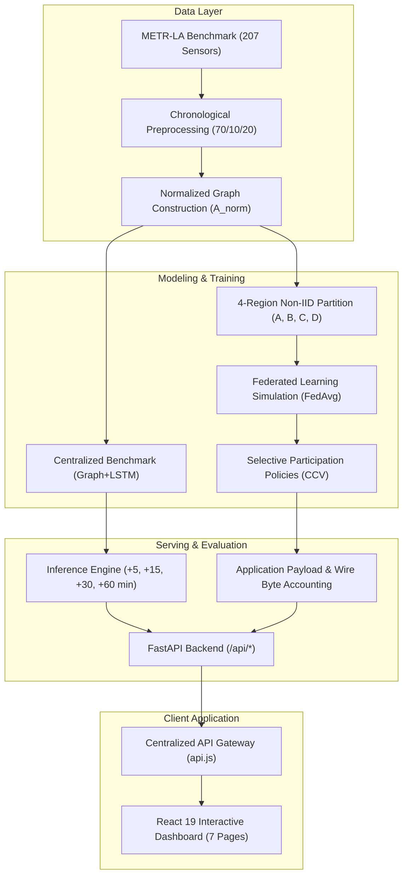

# TrafficPulse-X

> Federated traffic-speed forecasting and communication-cost evaluation using METR-LA, Graph+LSTM, FedAvg, selective client participation, and an interactive analysis dashboard.

[](https://www.python.org/downloads/)
[](https://pytorch.org/)
[](https://fastapi.tiangolo.com/)
[](https://react.dev/)
[](https://vitejs.dev/)
[](#testing)

---

## Problem Statement

### PS-003 — Federated Traffic-Flow Prediction with Communication-Cost Evaluation

Centralized intelligent transportation systems require continuous streaming of high-frequency sensor readings from municipal highway networks to a central datacenter. This paradigm faces critical operational limitations:

1. **Communication Bottlenecks**: Transmitting high-frequency telemetry across hundreds of loop detectors incurs substantial transmission costs and WAN congestion.
2. **Regional Heterogeneity (Non-IID Data)**: Highway sub-networks exhibit distinct local congestion patterns, bottleneck dynamics, and sensor densities, violating independent and identically distributed (IID) assumptions.
3. **Data Sovereignty & Privacy**: Centralizing telemetry across administrative boundaries poses governance challenges.
4. **Accuracy vs. Communication Trade-Off**: Standard evaluations report model accuracy in isolation without measuring the communication payload required to achieve it.

TrafficPulse-X evaluates whether decentralized federated training with selective client participation can match centralized forecast accuracy while reducing application-layer communication payload.

---

## Team Introduction Video

The team introduction video outlines team member roles, our problem analysis for PS-003, and the TrafficPulse-X solution architecture:

- [Watch Team Introduction Video](https://youtu.be/kbMFY39V_l4)
*(Note: Labelled strictly as Team Introduction Video; not a live municipal deployment).*

---

## Key Features

- **METR-LA Speed Forecasting**: Evaluated on 207 inductive loop sensors on Los Angeles County freeways.
- **Spatio-Temporal Graph+LSTM**: Joint architecture combining Chebyshev spectral graph convolutions with recurrent LSTM cells.
- **Multi-Horizon Projections**: Simultaneous forecasts at +5, +15, +30, and +60-minute horizons.
- **Centralized Benchmark**: Multi-model comparison across 7 baseline architectures.
- **4-Region Federated Simulation**: Decentralized FedAvg training across 4 non-IID geographic client sectors.
- **Selective Client Participation**: Client Contribution Value (CCV) policy scheduling evaluating 4 communication budget tiers.
- **Communication Payload Accounting**: Authoritative measurement of serialized model weight transfers (application payload).
- **Controlled Local Network-Byte Measurement**: Localhost socket benchmark quantifying HTTP/TCP framing overhead.
- **Decision Intelligence**: Dynamic 9-factor Need Score engine and Sensor Jury consensus for on-demand sensing.
- **Traffic Network Visualization**: Interactive 207-sensor spatial map with regional filtering and playback controls.
- **Replay-Aware Incident Alerts**: Attention and telemetry stream with historical incident indicators.
- **Historical Replay Engine**: Deterministic playback over 34,272 METR-LA observations (March–June 2012).
- **Live Data Streaming Adapter**: Pluggable provider interface for external streaming (Historical Replay default; unconfigured streams report 503 without fake fallback).
- **PeMS08 Traffic Flow Extension**: Verified public benchmark extension forecasting traffic flow volume (veh/5min) across 170 sensors in District 8.
- **Differential Privacy Add-On**: Evaluated Opacus DP-FedAvg experiment providing verified $(\epsilon = 5.311, \delta = 10^{-5})$-DP bounds.

---

## System Architecture



---

## Application Pages

The frontend console provides 7 canonical routes:

1. **/overview**: Executive operational summary, system metrics, next 60-minute forecast card.
2. **/network**: Spatial 207-sensor Leaflet map, historical replay controls, and regional cluster telemetry.
3. **/predictions**: Multi-horizon speed forecasts (+5m to +60m), uncertainty bounds, and 7-model comparative benchmark.
4. **/decision**: 9-factor Need Score breakdown, Next-Best Query ranking, Sensor Jury consensus, and physics plausibility gate.
5. **/federated**: 4-client partition cards, Round 8 convergence history, 3-seed reproducibility, and optional DP experiment.
6. **/communication**: CCV selective communication policies, 50% application-payload reduction, and controlled network wire accounting.
7. **/alerts**: Telemetry event stream with replay-aware incident indicators.

---

## Dataset

### Primary Dataset: METR-LA
- **Sensors**: 207 inductive loop detectors in Los Angeles County.
- **Temporal Range**: March 1, 2012 00:00:00 to June 27, 2012 23:55:00 UTC (34,272 timesteps at 5-minute intervals).
- **Target Variable**: Historical vehicle speed (`mph`).
- **Data Splits**: Train: 70% (23,967 samples) | Validation: 10% (3,404 samples) | Test: 20% (6,832 samples).
- **Note**: METR-LA provides vehicle speed only. Flow, occupancy, and incident ground truth are not present in this dataset.

### Optional Flow Extension: PeMS08
- **Sensors**: 170 loop detector stations in Caltrans District 8 (San Bernardino).
- **Temporal Range**: July 1, 2016 to August 31, 2016 (17,856 timesteps at 5-minute intervals).
- **Target Variable**: Traffic flow volume (`veh/5min`, mean: 230.22).
- Maintained as an isolated dataset extension in `data/processed/pems08/`.

---

## Forecasting Specification

- **Input Sequence**: 12 historical 5-minute observations (60 minutes).
- **Forecast Horizons**:
  - **+5 min** (Offset step 1)
  - **+15 min** (Offset step 3)
  - **+30 min** (Offset step 6)
  - **+60 min** (Offset step 12)
- **Model Inputs**: Normalized speed tensor `[B, 12, 207, 2]` (Channel 0: z-score normalized speed, Channel 1: sensor validity mask).

---

## Federated Setup

The 207 sensors are partitioned into 4 geographic regional client clusters:

| Regional Client | Sector | Sensor Count | Valid Target Samples ($n_i$) | FedAvg Weight ($w_i$) |
| :--- | :--- | :---: | :---: | :---: |
| **Region A** | North-East | **48** | 4,221,681 | `0.229069` |
| **Region B** | South-East | **57** | 5,107,193 | `0.277117` |
| **Region C** | Central-West | **58** | 5,150,335 | `0.279458` |
| **Region D** | North-West | **44** | 3,950,552 | `0.214357` |
| **Total** | — | **207** | **18,429,761** | **1.000000** |

- **Non-IID Partitioning**: Clients capture distinct geographic subgraphs with differing highway topologies and traffic dynamics.
- **Aggregation Protocol**: Weighted Federated Averaging (`FedAvg`) aggregating local model updates after 20 training steps per round.

---

## Verified Results

Empirical results evaluated across 6,832 test-set samples on METR-LA:

| Architecture | Test MAE (mph) | Test RMSE (mph) | Test MAPE (%) | Parameters | Best Epoch / Round |
| :--- | :---: | :---: | :---: | :---: | :---: |
| **Centralized Spatial Graph+LSTM** | **3.4378** | **6.8873** | **9.57%** | 26,596 | Epoch 12 |
| **FedAvg Decentralized (4 Clients)** | **3.5322** | **7.0956** | **9.99%** | 26,596 | Round 8 (Val MAE: 3.1536) |

*Delta ($\Delta$ FedAvg vs Centralized): $+0.0944\text{ mph}$ (+2.75%) MAE penalty under decentralized training.*

---

## Communication Evaluation

### Application Payload Accounting (Authoritative Project Metric)
Model update transfer size: **110,271 Bytes** per client per round (serialized PyTorch state dict).

| Policy Tier | Active Clients / Round | Total Transfers (13 Rds) | Application Payload | Reduction vs. Full |
| :---: | :---: | :---: | :---: | :---: |
| **4/4 (Full)** | 4 | 104 | 11,468,184 B (11.47 MB) | Baseline (0.0%) |
| **3/4** | 3 | 78 | 8,601,138 B (8.60 MB) | 25.0% |
| **2/4** | 2 | 52 | **5,734,092 B (5.73 MB)** | **50.0% (Pareto-Optimal)** |
| **1/4** | 1 | 26 | 2,867,046 B (2.87 MB) | 75.0% |

*Note: These figures represent application-layer serialization payload. They do not model physical cellular network transmission costs or carrier overhead.*

### Secondary Benchmark: Controlled Network Transfer Bytes — Local Test
Measured over local loopback sockets (`127.0.0.1:8000`) over HTTP/1.1 to quantify wire framing and HTTP header overhead:
- **4/4 Full Policy**: 11,502,380 measured wire bytes (+34,196 bytes / +0.298% transport overhead).
- **2/4 50% Policy**: 5,751,190 measured wire bytes (+17,098 bytes / +0.298% transport overhead).
- *Strict boundary: Local transport experiment only; not a cellular network measurement.*

---

## Streaming Modes

- **Historical Replay (Default)**: Deterministic replay over 34,272 METR-LA timestamps.
- **External Stream (Optional)**: Pluggable adapter interface. If external API configuration is absent, the system explicitly returns `503 Unavailable / Not Configured`.
- **Integrity Guarantee**: The system never falls back to fabricated or synthetically randomized telemetry when external streams are unavailable.

---

## Technology Stack

- **Backend / Machine Learning**:
  - Python 3.10+
  - PyTorch (`torch>=2.0.0`)
  - FastAPI (`fastapi>=0.110.0`)
  - Uvicorn (`uvicorn>=0.28.0`)
  - NumPy (`numpy>=1.24.0`), Pandas (`pandas>=2.0.0`), SciPy (`scipy>=1.10.0`), PyTables (`tables>=3.8.0`)
  - Opacus (`opacus>=1.4.0`, optional differential privacy module)
  - Pytest (`pytest>=8.0.0`), HTTPX (`httpx>=0.27.0`)
- **Frontend**:
  - React 19 (`react^19.2.8`, `react-dom^19.2.8`)
  - React Router (`react-router-dom^7.18.4`)
  - Leaflet & React-Leaflet (`leaflet^1.9.4`, `react-leaflet^5.0.0`)
  - Recharts (`recharts^3.10.1`)
  - Tailwind CSS v4 (`tailwindcss^4.3.3`, `@tailwindcss/vite^4.3.3`)
  - Lucide React (`lucide-react^1.52.0`)
  - Vite (`vite^8.3.0`), Oxlint (`oxlint^1.81.0`)

---

## Repository Structure

```
.
├── backend/                             # FastAPI application & server services
│   ├── communication_intelligence/     # CCV policy evaluation & accounting
│   ├── data_sources/                   # Streaming adapter & PeMS08 adapter
│   ├── datasets/                       # METR-LA data loaders & inspectors
│   ├── decision/                       # Need Score, Sensor Jury, Physics Gate
│   ├── experiments/                    # 3-seed reproducibility & flow routers
│   ├── federated/                      # FedAvg service & regional partition state
│   ├── prediction/                     # Multi-horizon inference & benchmark service
│   ├── privacy/                        # Differential privacy experiment router
│   ├── main.py                         # Single FastAPI application instance (68 routes)
│   └── requirements.txt                # Direct backend Python dependencies
├── data/
│   ├── processed/metr-la/              # Checkpoints, metadata, regions, experiments
│   ├── processed/pems08/               # Flow model checkpoint, evaluation JSON, scaler
│   ├── raw/metr-la/                    # METR-LA graph sensor locations & adj_mx.pkl
│   └── raw/pems08/                     # PeMS08 dataset info & distance.csv
├── docs/                               # Technical & scientific documentation
│   ├── ARCHITECTURE.md                 # System architecture & component pipelines
│   ├── EXPERIMENTS.md                  # Comprehensive empirical experiment logs
│   ├── API.md                          # API route namespaces & schema reference
│   ├── SCIENTIFIC_SCOPE.md             # Scientific contracts, boundaries & checksums
│   └── screenshots/                    # Representative UI screenshots (7 canonical views)
├── ml/                                 # PyTorch models, FL simulation & privacy
│   ├── experiments/                    # 3-seed training & IID partition scripts
│   ├── federated/                      # FedAvg client/server simulation
│   ├── privacy/                        # Opacus DP training harness
│   └── spatiotemporal/                 # SpatialGraphLSTM model definition
├── src/                                # React 19 frontend application
│   ├── components/                     # Modular UI components (traffic, prediction, etc.)
│   ├── context/                        # ReplayContext (global temporal clock)
│   ├── pages/                          # 7 canonical page views
│   └── services/api.js                 # Centralized API gateway (single source of truth)
├── .env.example                        # Safe environment variable configuration template
├── .gitignore                          # Standard Python, Node, and build exclusions
├── package.json                        # Frontend dependencies & scripts
├── vite.config.js                      # Vite bundler configuration
└── README.md                           # This document
```

---

## Installation

### Prerequisites
- Python 3.10 or higher
- Node.js 18 or higher (with npm)

### Backend Setup
```bash
# 1. Create and activate a Python virtual environment
python -m venv .venv
# On Windows (PowerShell):
.\.venv\Scripts\Activate.ps1
# On Linux/macOS:
source .venv/bin/activate

# 2. Install backend dependencies
python -m pip install -r backend/requirements.txt
```

### Frontend Setup
```bash
# Install frontend dependencies
npm install
```

---

## Running Locally

### 1. Start Backend API Server
```bash
python -m uvicorn backend.main:app --host 127.0.0.1 --port 8000
```
- API Documentation (Swagger): `http://127.0.0.1:8000/docs`
- Health Endpoint: `http://127.0.0.1:8000/api/health`

### 2. Start Frontend Development Server
```bash
npm run dev -- --host 127.0.0.1 --port 5173
```
- User Interface: `http://127.0.0.1:5173/`

---

## Testing

Verify the complete repository with the following commands:

```bash
# 1. Backend Pytest Suite (343 passed)
python -m pytest backend -q

# 2. Frontend Linting (0 errors, 21 warnings)
npm run lint

# 3. Frontend Production Build (clean bundle in ~7.3s)
npm run build
```

---

## API Overview

All routes are hosted on the single backend instance under `/api/*`:

- `/api/health` — System status and server uptime
- `/api/datasets/*` — METR-LA metadata, 207-sensor snapshots, regions, and heartbeats
- `/api/prediction/*` — Speed forecasts (+5m to +60m), uncertainty bounds, model benchmarks
- `/api/decision/*` — 9-factor Need Score, Sensor Jury consensus, Next-Best Query ranker
- `/api/federated/*` — FedAvg status, Round 8 convergence history, India municipal case studies
- `/api/communication/*` — CCV selective communication policies and application-payload accounting
- `/api/streaming/*` — Historical replay and optional external live streaming status
- `/api/experiments/*` — 3-seed reproducibility, IID comparison, DP evaluation, PeMS08 flow forecasts, and network accounting

---

## Scientific Scope & Limitations

1. **Historical Replay as Primary Execution**: All demonstrations use deterministic replay of the METR-LA benchmark. No claims are made of active municipal live deployments.
2. **No Physical Bandwidth Claims**: Telemetry reduction is reported as **Application Payload** (serialized tensor bytes). Cellular radio bandwidth savings are not claimed.
3. **Controlled Transport Benchmark**: Network-byte measurements are conducted over localhost sockets to quantify protocol framing, not field wireless links.
4. **Differential Privacy Boundaries**: Formal $(\epsilon, \delta)$-DP guarantees apply exclusively to the optional Opacus experiment add-on, not the standard FedAvg baseline.
5. **No Fabricated Data**: Unconfigured external streaming endpoints report unavailable without synthetic fallback.

For complete contracts and SHA-256 artifact checksums, see [docs/SCIENTIFIC_SCOPE.md](docs/SCIENTIFIC_SCOPE.md).

---

## Screenshots

Representative views from the 7 canonical application routes:

| Route | Description | Preview |
| :--- | :--- | :---: |
| **Traffic Network** | Interactive 207-sensor Leaflet map with replay controls | [network.png](docs/screenshots/network.png) |
| **Predictions** | Multi-horizon forecasts with uncertainty intervals & 7-model benchmark | [predictions.png](docs/screenshots/predictions.png) |
| **Decision Intelligence**| 9-factor Need Score & Sensor Jury consensus | [decision.png](docs/screenshots/decision.png) |
| **Federated Learning** | 4-client FedAvg convergence & 3-seed reproducibility | [federated.png](docs/screenshots/federated.png) |
| **Communication** | CCV selective communication policies & 50% application payload reduction | [communication.png](docs/screenshots/communication.png) |

---

### References

1. **McMahan, B., Moore, E., Ramage, D., Hampson, S., & y Arcas, B. A.** (2017). *Communication-Efficient Learning of Deep Networks from Decentralized Data*. AISTATS. [https://arxiv.org/abs/1602.05629](https://arxiv.org/abs/1602.05629) / [MLR Proceedings](https://proceedings.mlr.press/v54/mcmahan17a.html)
2. **Li, Y., Yu, R., Shahabi, C., & Liu, Y.** (2018). *Diffusion Convolutional Recurrent Neural Network: Data-Driven Traffic Forecasting*. ICLR. [https://arxiv.org/abs/1707.01926](https://arxiv.org/abs/1707.01926)
3. **Yu, B., Yin, H., & Zhu, Z.** (2018). *Spatio-Temporal Graph Convolutional Networks: A Deep Learning Framework for Traffic Forecasting*. IJCAI. [https://arxiv.org/abs/1709.04875](https://arxiv.org/abs/1709.04875)
4. **Jaggi, M. et al.** (2014). *Communication-Efficient Distributed Dual Coordinate Ascent*. NeurIPS. [https://arxiv.org/abs/1409.1458](https://arxiv.org/abs/1409.1458)
5. **Hochreiter, S., & Schmidhuber, J.** (1997). *Long Short-Term Memory*. Neural Computation. [https://doi.org/10.1162/neco.1997.9.8.1735](https://doi.org/10.1162/neco.1997.9.8.1735)
6. **METR-LA Benchmark Dataset**: Los Angeles County Highway Network via Caltrans PeMS. [https://github.com/liyaguang/DCRNN](https://github.com/liyaguang/DCRNN)
7. **Caltrans Performance Measurement System (PeMS)**: California Department of Transportation. [https://dot.ca.gov/programs/traffic-operations/mpr/pems-source](https://dot.ca.gov/programs/traffic-operations/mpr/pems-source)
8. **Differential Privacy / DP-SGD**: Abadi et al. [https://arxiv.org/abs/1607.00133](https://arxiv.org/abs/1607.00133) • [Opacus](https://opacus.ai/)
9. **Practical Secure Aggregation for Privacy-Preserving Machine Learning**: Bonawitz et al. [Google Research](https://research.google/pubs/practical-secure-aggregation-for-privacy-preserving-machine-learning/)
10. **Communication-Efficient Federated Learning on Non-IID Data**: Sattler et al. [IEEE Xplore](https://ieeexplore.ieee.org/document/8889996)

---

## Documentation

Comprehensive project documentation is maintained in the [`docs/`](docs/) directory:
- [Architecture Specifications](docs/ARCHITECTURE.md)
- [Scientific Contracts & Provenance](docs/SCIENTIFIC_CONTRACT.md)
- [Engineering & Development Guide](docs/DEVELOPMENT.md)
- [Demo & Viva Presentation Guide](docs/DEMO_VIVA.md)
- [Release Audit Report](docs/AUDIT_REPORT.md)
- [Complete Technical Documentation Source (Markdown)](docs/TrafficPulse-X_Complete_Documentation.md)

---

## License

**Status**: `LICENSE MISSING`
*Recommendation: MIT License or Apache 2.0. To be finalized upon project owner authorization.*
